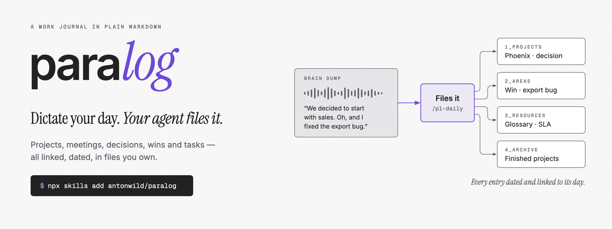
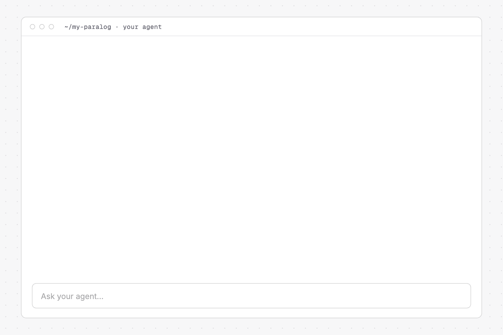

A work journal in plain Markdown, run by your AI agent. Best with Obsidian, works in any editor.
Dictate your day. The agent files it into a [PARA](https://fortelabs.com/blog/para/) vault: projects, meetings, decisions, wins and tasks, all linked and dated.

Made for corporate work: prepare 1:1s and reviews from your own wins and goals, send meeting recaps and weekly updates, and answer "when did we decide that?" with sources.

- **Markdown only.** No database, no server. Your notes stay plain files. Obsidian adds clickable links, a table of your days (`Journal.base`) and the optional Tasks plugin; VS Code or any other editor reads the same files.
- **Every entry is dated** and links to the daily note it came from. Your words in the brain dump are never changed.
- **Your own work.** Entries are about your projects, meetings, decisions and wins.
- **Facts only.** The agent never invents names, dates or numbers, and says what it could not find.
- **Any agent** that reads skills: Claude Code, Codex, Cursor and others.

## Install

You need an AI agent (e.g. [Claude Code](https://claude.com/claude-code)).

```bash
mkdir ~/my-paralog && cd ~/my-paralog      # or an existing vault folder
npx skills add antonwild/paralog           # installs the skills
claude                                     # open your agent here, then run:
/pl-setup
```

`/pl-setup` asks a few questions (your name, languages, Tasks plugin, git) and builds the vault. Then open the folder in [Obsidian](https://obsidian.md) (*Open folder as vault*, recommended) or your Markdown editor.

**No npm at work?** Clone the repo and run `./install.sh ~/my-paralog`, then `/pl-setup`. Add `--copy` on Windows.

**Update:** `npx skills update` (or `git pull`), then `/pl-setup` again. It shows what changed and never touches your notes. `/pl-daily` tells you when an update is waiting.

## Use it



| When                                                                                                      | Run                             |
|-----------------------------------------------------------------------------------------------------------|---------------------------------|
| Morning: read `## Today` at the top of today's note — meetings to prepare, recaps to send, what is due, the next command. | — |
| End of the day: dictate under `## Brain Dump` in today's note, talk to your agent in the chat, or just run it and answer its questions. It also writes the next work day's `## Today`. | `/pl-daily` |
| Before a meeting or your 1:1                                                                              | `/pl-prep [meeting or project]` |
| After a meeting: follow-up email                                                                          | `/pl-recap [meeting]`           |
| Friday: weekly update for your manager                                                                    | `/pl-week`                      |

When you need it:

|                            |                                                                                   |
|----------------------------|-----------------------------------------------------------------------------------|
| `/pl-evidence <question>`  | What was decided, when, by whom — with quotes, dates and commit times. Read-only. |
| `/pl-prep year-end review` | Your milestones and wins of the year, grouped by goal.                            |
| `/pl-prep promotion`       | Your evidence for each expectation of the next level, and the gaps.               |
| `/pl-handover <project>`   | One page for your deputy (vacation, leaving).                                     |
| `/pl-timeline <project>`   | Mermaid chart of the key dates.                                                   |
| `/pl-archive <project>`    | Closing summary, then moves it to `4_Archive`. Links keep working.                |
| `/pl-check`                | Finds broken links, duplicate tasks, stale projects. Once a week.                 |
| `/pl-setup`                | Update the vault, or change the setup.                                            |

Step-by-step examples: **[WORKFLOWS.md](WORKFLOWS.md)**.

**Try it first:** the [demo vault](skills/pl-setup/assets/demo/) has three weeks of a made-up project manager's work. Install the skills in a new, empty folder and run `/pl-setup demo`. Then open it in Obsidian and try the commands.

## Data and compliance

Read this before you use paralog for work.

- **Your AI agent reads your notes.** The content goes to the agent's provider. Use an account your company approves for work data.
- **The `npx skills` installer sends anonymous usage telemetry** to skills.sh: the repo, the skill names and your agent type. Never your notes. To turn it off, set `DISABLE_TELEMETRY=1` (or `DO_NOT_TRACK=1`) before you run it: `DISABLE_TELEMETRY=1 npx skills add antonwild/paralog`. `install.sh` sends nothing.
- **Git stays local by default.** Each change is committed, so you can see when a note was written. Pushing is off (`git_push: off` in `_system/config.md`). Turn it on only for a remote your company allows — not a personal GitHub account.
- **Works council / data protection:** some companies must approve tools that could monitor employees. paralog is designed not to: no notes about people, no evaluation of colleagues. If in doubt, ask before you use it at work.
- **Commit times are not proof.** They come from your computer clock. A recap email that others received is stronger evidence. `/pl-recap` writes one.

## Your days as a table (Obsidian only)

`/pl-daily` gives each processed day a few properties: a one-line summary, the projects, meetings and areas it filed into, up to 5 topics, and how many decisions, wins, milestones and `#for-manager` items came from that day. Open `Journal.base` in Obsidian 1.9 or newer: all days, the last 14 days, days with decisions or wins, days with items for your manager. Filter by a project or topic without opening each note.

The links and counts come from the notes themselves, so `/pl-check` can find and fix values that are wrong. There is never a property about people. After an update, run `/pl-check` once to fill in older days. Other editors show the properties as plain YAML.

## Optional: Tasks plugin (Obsidian only)

With the Obsidian [Tasks](https://publish.obsidian.md/tasks/) plugin, every task lives in its daily note with a tag and dates. Projects, meetings and `Tasks.md` show live lists. Answer `Yes` in `/pl-setup`, or set `tasks_plugin: on` in `_system/config.md` and run `/pl-setup`. Not using Obsidian? Keep it off: other editors show the live lists as code blocks, and tasks would only be visible in the daily notes.

Plugin settings: global filter `#task`, *Tasks Emoji Format*, "Set done date on every completed task" on. Rules: `_system/rules.md` section 11.

## How it works

```
skills/                 the agent skills (SKILL.md format)
  pl-setup/
    scripts/scaffold.sh builds or updates a vault
    scripts/check.sh    read-only vault checks, used by /pl-check
    scripts/props.sh    daily note properties: derives them from the vault, lists days (read-only)
    assets/vault/       files for the vault: AGENTS.md, rules, config, templates, Journal.base, git hook
    assets/tasks/       replacements when the Tasks plugin is on
    assets/demo/        the demo vault (/pl-setup demo): three weeks of made-up work
install.sh              fallback installer without npx
dev/link-vault.sh       for development: keeps a test vault in sync with this repo
dev/refresh-demo.sh     for development: updates and checks the demo vault
```

In the vault, `_system/rules.md` says what goes where. Every skill reads it first. `_system/config.md` holds your settings. Rules and templates belong to paralog and are replaced on update. The config and your notes belong to you and are never overwritten.

## Feedback

Bug reports and ideas are welcome as [issues](https://github.com/antonwild/paralog/issues). Never paste notes from your work vault — use a made-up example. I don't accept pull requests.

## Development

1. Clone the repo. Set up a test vault: `./install.sh ~/paralog-test`, run `/pl-setup` in it.
2. Run `dev/link-vault.sh ~/paralog-test`. The skills are linked, and after every commit in this repo the vault gets the new rules and templates.
3. When a release changes vault files, bump `paralog_version` in `skills/pl-setup/assets/vault/_system/rules.md` and add a line to [CHANGELOG.md](CHANGELOG.md). Bring the demo up to date: `dev/refresh-demo.sh`.

## License

[MIT](LICENSE)
