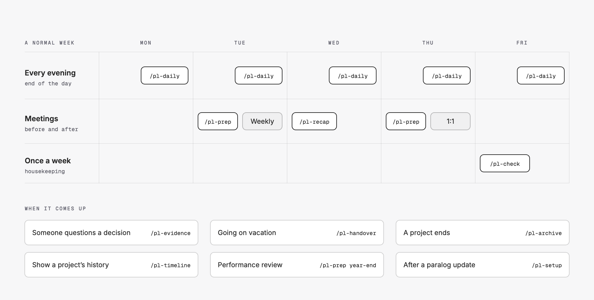
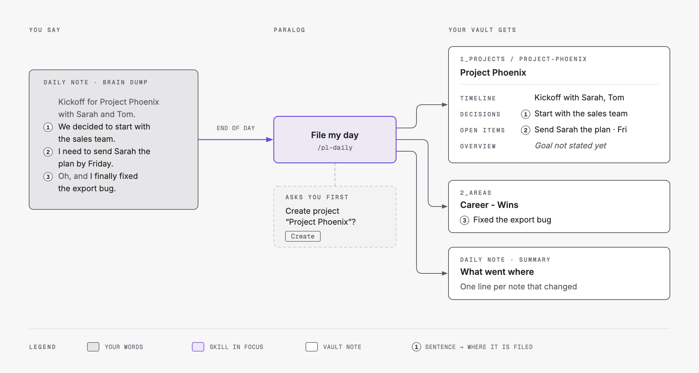
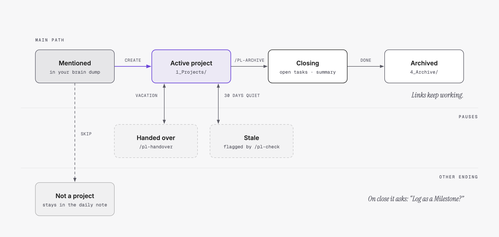
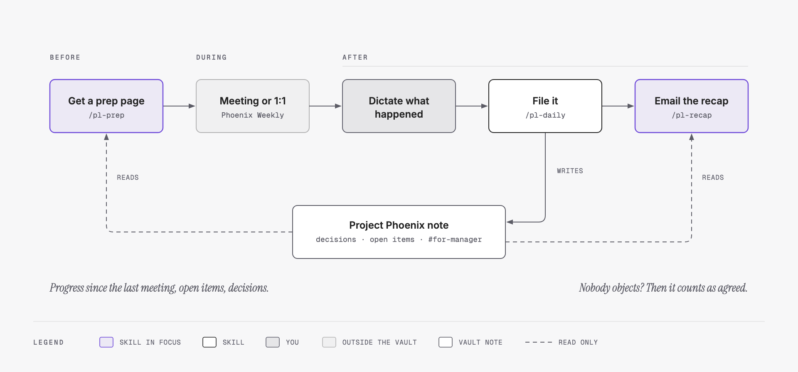

# Sample workflows

How to use paralog in a normal work week. All names are examples.

Commands start with `/` and run in your agent (e.g. Claude Code), opened in the vault folder.



---

## 1. First setup

1. In a new folder, run `npx skills add antonwild/paralog` (or `./install.sh <folder>` from a clone).
2. Open your agent in the folder and run `/pl-setup`. Answer the questions: your name, your languages, Tasks plugin, git.
3. Open the folder in Obsidian (*Open folder as vault*), or in any Markdown editor. In Obsidian, optionally install the **Calendar** plugin.

You can change all settings later in `_system/config.md`. Run `/pl-setup` again after you change `tasks_plugin`.

---

## 2. Your daily routine (5 minutes)



**When:** at the end of the day.

1. Open today's daily note (Calendar plugin, or *Open today's daily note* in the command palette).
2. Dictate your day under `## Brain Dump`. Talk freely, in any language:
   > "Kickoff for Project Phoenix with Sarah and Tom. We decided to start with the sales team. I need to send Sarah the plan by Friday. Oh, and I finally fixed the export bug."
3. Run `/pl-daily`.
4. Answer the questions it asks, e.g. *"Create project Project Phoenix?"* → `Create`.

**Result:**
- `Project Phoenix` has the kickoff, the decision and the task.
- `Career - Wins` has the bug fix.
- The daily note's `## Summary` lists what went where.

Run `/pl-daily` again later the same day if you add more. It files only the new parts.

---

## 3. A new project starts



Just mention it in your dump: *"We started the vendor migration today."*

`/pl-daily` asks: *"Create project Vendor Migration?"* → `Create`.

**Result:** `1_Projects/Vendor-Migration/Vendor Migration.md` with goal, status, timeline, decisions and open items. Everything you say about it later goes there.

---

## 4. Before and after a meeting



**Before:**
```
/pl-prep Phoenix Weekly
```
You get one page: progress since the last meeting, open items and decisions.

**After:** dictate what happened in your daily dump, run `/pl-daily`, then:
```
/pl-recap Phoenix Weekly
```
**Result:** an email draft with decisions, action items (owner + deadline) and open questions. Copy it into your email program and send it.

Why send it? Attendees received it in writing. If nobody objects, it counts as agreed.

---

## 5. 1:1 with your manager

1. `/pl-prep`, with no name, asks what to prepare. Choose `Manager 1:1`.
2. You get your top wins, project updates and every open `#for-manager` question.
3. After the 1:1, dictate the answers: *"Jane approved the extra licenses."*
4. `/pl-daily` closes the open question and records the answer with its date.

**Tip:** say "I need to ask my manager…" in your dump. That creates a `#for-manager` item automatically.

---

## 6. Someone questions a decision

> "We never agreed to start with sales!"

```
/pl-evidence When did we decide to start Phoenix with the sales team?
```

**Result:**
- **Answer** in one sentence.
- **Evidence**: date, your exact words from that day, where it was filed, and the git commit time that shows when it was written down.
- **Not found**: what the vault does *not* say.

`/pl-evidence` only reads. It never changes your notes.

---

## 7. Performance review

```
/pl-prep year-end review
```

**Result:** your Milestones of the year (go-lives, finished projects), your smaller wins grouped into themes, and the projects you completed. Every point links to its source.

Wins are logged automatically by `/pl-daily`. Big ones become **Milestones**. If unsure, it asks you.

---

## 8. Going on vacation

```
/pl-handover all active projects
```

**Result:** one page per project: goal, status, next steps, key decisions, people, meetings and where to find things. Send it to your deputy.

---

## 9. A project ends

```
/pl-archive Project Phoenix
```

1. It asks what to do with open tasks: keep, close or move.
2. It writes a closing summary.
3. It moves the project, with its meetings, to `4_Archive`.
4. It asks: *"Log as a Milestone?"*

All links keep working.

---

## 10. Save something to look up later

Say it in your dump:
> "Remember: the customer data is in the CRM export folder. SLA means service level agreement. And Procurement signs off vendor contracts."

**Result:** a row in `Where to Find`, a row in `Glossary` and a row in `Teams`. No new notes, no dates. Just one table per topic.

---

## 11. See the history as a chart

```
/pl-timeline Project Phoenix
```

**Result:** a Mermaid chart of the key dates: start, decisions, milestones, planned go-live. One section per month. It is saved in the project note under `## Timeline Chart` and replaced on every run.

`/pl-handover`, `/pl-archive`, `/pl-evidence` and `/pl-prep year-end review` add the same chart when there are at least 3 dates.

---

## 12. Tasks with the Tasks plugin (optional, Obsidian only)

Turn it on: `tasks_plugin: on` in `_system/config.md`, then run `/pl-setup`.

1. Dictate: *"I need to send Sarah the plan by Friday, it's urgent."* Or type it under `## Tasks` in the daily note: `- [ ] Send Sarah the plan #task`.
2. Run `/pl-daily`.

**Result:** the line in the daily note becomes:
```
- [ ] Send the plan to Sarah Miller ([[2026-10-17]]) #task #project/phoenix ⏫ 📅 2026-10-23
```
- It shows in `Project Phoenix` → `Open Items`, without the tags.
- It shows in `Dashboards/Tasks` under *Upcoming*, then *Today*, then *Overdue*.
- Each daily note lists the tasks due by that day.

Tick it in any of these lists. `/pl-daily` also ticks it when you say *"sent Sarah the plan"*.

---

## 13. Keep the vault clean

Once a week:
```
/pl-check
```
**Result:** a short list of problems — broken links, duplicate tasks, projects with no news for 30 days. It offers to fix them. Nothing changes without your answer.

---

## 14. Update paralog

```
npx skills update
/pl-setup
```
`/pl-setup` lists the changed rules and templates and asks before it replaces them. Your notes and settings stay. `/pl-daily` tells you when an update is waiting.

---

## Quick reference

| You want to… | Run |
|---|---|
| File your day | `/pl-daily` |
| Prepare a meeting or your 1:1 | `/pl-prep [meeting or project]` |
| Send a follow-up email | `/pl-recap [meeting]` |
| Find what was decided, and when | `/pl-evidence <question>` |
| Write a year-end review | `/pl-prep year-end review` |
| Hand over work | `/pl-handover <project>` |
| Draw a timeline chart | `/pl-timeline <project or topic>` |
| Close a project | `/pl-archive <project>` |
| Check the vault | `/pl-check` |
| Set up or update the vault | `/pl-setup` |
