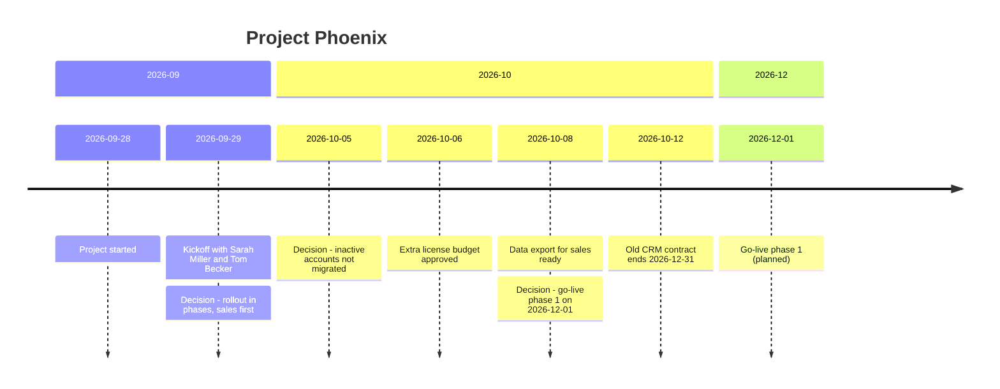

# Project Phoenix

## Overview
- **Goal:** Move the sales and support teams from the old CRM to Salesforce.
- **Why it matters:** The old CRM runs out at the end of 2026.
- **Stakeholders:** Sarah Miller (Sales Ops), Tom Becker (Data Platform)
- **My role:** Project lead

## Status
**Current:** Data cleanup for sales running. Go-live phase 1 planned for 2026-12-01.

## Timeline Chart

*Generated [[2026-10-14]] from the Timeline/Log. Do not edit by hand.*

## Timeline
### 2026-09
- [[2026-09-28]] — **Created.** My manager asked me to lead the CRM replacement.
- [[2026-09-29]] — **Kickoff** with Sarah Miller and Tom Becker, see [[Phoenix Kickoff 2026-09-29]].
- [[2026-09-29]] **Decision:** Rollout in phases, sales team first.

### 2026-10
- [[2026-10-01]] — First [[Phoenix Weekly]]. Tom Becker: the data export for sales takes 2 weeks.
- [[2026-10-02]] — Sent the project plan to Sarah Miller.
- [[2026-10-05]] — Data mapping finished for all 42 sales fields.
- [[2026-10-06]] — My manager approved the budget for two extra Salesforce licenses.
- [[2026-10-08]] — Data export for the sales accounts ready, one week ahead of plan.
- [[2026-10-08]] **Decision:** Go-live phase 1 on 2026-12-01.
- [[2026-10-12]] — The old CRM contract ends 2026-12-31. Extension as fallback, see [[Vendor Management]].

## Decisions
### 2026-10
- [[2026-10-05]] **Decision:** Inactive accounts older than 3 years are not migrated. They stay in the old CRM export. *Why:* about 30% of the accounts have no activity since 2023. *Who:* Tom Becker, me.

## Open Items
- [x] Ask for budget for two extra Salesforce licenses for the test users #for-manager ([[2026-10-01]]) → approved ([[2026-10-06]])
