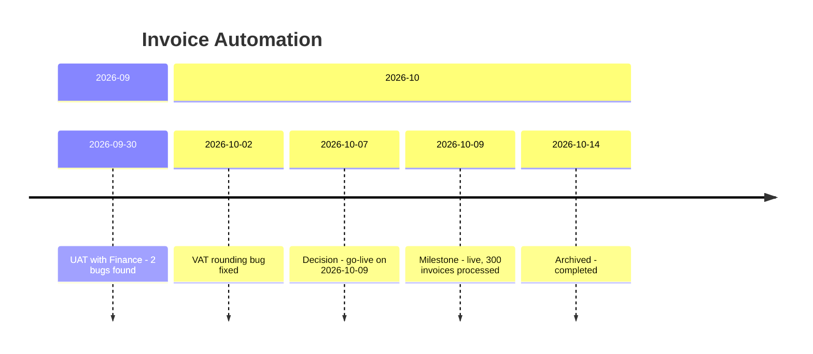

# Invoice Automation

## Closing Summary
- **Archived:** [[2026-10-14]] — completed
- **Outcome:** Supplier invoices are processed automatically. 300 invoices in the first run, 280 in the second.
- **Key decisions:** [[2026-10-07]] go-live on 2026-10-09.
- **My contributions:** Led the UAT and the vendor fixes, see the Milestone in [[Career - Wins]].

## Overview
- **Goal:** Process supplier invoices automatically instead of typing them in by hand.
- **Why it matters:** 
- **Stakeholders:** Priya Nair (Finance)
- **My role:** Project lead

## Status
**Current:** Live since 2026-10-09. Completed.

## Timeline Chart

*Generated [[2026-10-14]] from the Timeline/Log. Do not edit by hand.*

## Timeline
### 2026-09
- [[2026-09-28]] — Added to the vault. The project runs since August. UAT with Finance on 2026-09-30.
- [[2026-09-30]] — UAT with Priya Nair, see [[Invoice UAT 2026-09-30]]. 2 bugs found, one fixed the same day.

### 2026-10
- [[2026-10-02]] — The vendor fixed the VAT rounding bug. Priya Nair confirmed the fix.
- [[2026-10-07]] **Decision:** Go-live on 2026-10-09.
- [[2026-10-09]] — Went live. The first run processed 300 invoices automatically.
- [[2026-10-14]] — Second run: 280 invoices, no problems (Priya Nair).
- [[2026-10-14]] — **Archived** (completed).

## Decisions
### 2026-10
- [[2026-10-07]] **Decision:** Go-live on 2026-10-09. *Why:* UAT passed, both bugs fixed. *Who:* Priya Nair, me.

## Open Items
