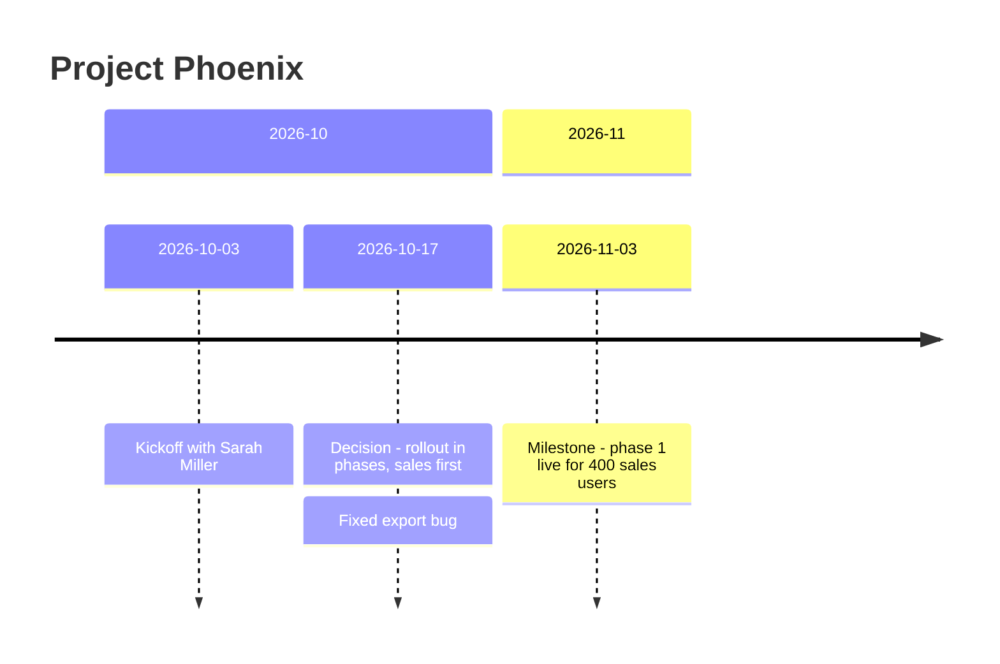

# Vault Rules

These rules apply to every agent and every skill that writes to this vault.
Settings (name, languages, Tasks plugin, ...) live in [[config]].

## 1. Folders — what goes where

| Folder | Holds | Create a new note when… | Do NOT put here |
|---|---|---|---|
| `0_Daily` | One note per day (created by Obsidian's daily notes or the Calendar plugin). Raw **Brain Dump** + agent **Summary** (+ **Recaps** from `/pl-recap`, + **Weekly Update** from `/pl-week`, + **Tasks** if `tasks_plugin: on`). | Never by hand — the daily note for the date. | Anything else. |
| `1_Projects` | Work with a **goal and an end**. One folder per project: `1_Projects/<Folder-Name>/<Name>.md`, its meetings in `1_Projects/<Folder-Name>/Meetings/`. | A piece of work with an outcome that spans more than one day, is mentioned as ongoing, or the user calls it a project. | Single tasks, one-off questions. |
| `2_Areas` | Things with **no end date**: ongoing responsibilities (hiring, on-call), `Career - Wins`, `Career - Goals`. General meetings (no project) in `2_Areas/Meetings/`. One file each. | An ongoing responsibility shows up. | Meetings of a project — those go into the project's `Meetings` folder. |
| `3_Resources` | Reference material in a few broad **collection notes** (see section 7). Flat — no subfolders. | Almost never: add to an existing collection instead. See section 7. | Events, decisions, progress. |
| `4_Archive` | Finished or inactive projects, areas and general meetings. | Only through the `pl-archive` skill. | Active work. |

### Meetings

**Every meeting gets its own note** (`type: meeting`, template `Meeting.md`) — recurring and one-off.
- **About one project** → `1_Projects/<Folder-Name>/Meetings/<Name>.md`, with `project: "[[Project Name]]"`.
- **About several projects** → in the folder of the main project; link the others in `## Purpose`.
- **About no project** (1:1, team standup, town hall) → `2_Areas/Meetings/<Name>.md`, `project` empty.
- **Names:** recurring meetings use the series name (`Phoenix Weekly`). One-off meetings end with their date (`Vendor Workshop 2026-10-20`).
- Create the `Meetings` folder with the first meeting. No empty folders.
- **Status:** `active` while the series runs. A series that stops gets `status: ended` and stays in place; it moves with its project at archive time. A one-off meeting gets `status: ended` once it has happened. General meetings that ended can be moved to `4_Archive` with `/pl-archive`.
- Each occurrence is one entry in the meeting's `## Log`. Important results (decisions, milestones) also get one line in the project `Timeline`.

Rule of thumb: **Did something happen?** → log it in a project, area or meeting.
**Is it something to look up later?** → resource.

## 2. Writing rules

1. **The Brain Dump is sacred.** Never edit, fix, reformat or delete anything under `## Brain Dump`. It is the dated source of truth.
2. **Logs are append-only** (projects, areas, meetings — not resources, see section 7). Add new lines at the bottom of `Timeline`, `Log`, `Decisions`, `Wins`. Never rewrite or delete old entries. If something was wrong, add a correction entry.
3. **Every log entry starts with its source date as a link** to the daily note, e.g. `- [[2026-10-17]] — ...`. This is what makes the vault work as evidence.
4. **Facts, not interpretation.** Write what was said, decided, or done, and by whom. Never invent names, dates, numbers or reasons. If the dictation is unclear, write `(unclear in dictation)` instead of guessing.
5. **Each task exists once.** Put it in the `## Open Items` of the note it belongs to (usually the project). Do not copy it into other notes — `#for-manager` is enough for `pl-prep` to find it.
   **The open tasks of a note** are its `- [ ]` lines in `## Open Items`. For a project, add the open tasks of its `Meetings` notes. With `tasks_plugin: on`, tasks live in the daily notes instead: use section 11 for where to write, find and close them. Skills say "open tasks of a note" and mean this rule.
6. **Link generously.** Link projects, areas and meetings with `[[Name]]` the first time they appear in an entry. Never link people: names are plain text (section 6).
7. **Only three things may be overwritten** in logs: the single `**Current:**` line under `## Status` in a project, the `**Status:**` line of a goal (section 3b), and ticking a task checkbox (`- [ ]` → `- [x]`) when it is resolved. When ticking, append the result and source: `- [x] Ask about budget #for-manager → approved ([[2026-10-20]])`. With `tasks_plugin: on` use the format in section 11. Exception: the `## Timeline Chart` section is a generated view, not a log. Agents replace it as a whole (section 10).
8. **Dates** are always `YYYY-MM-DD`.
9. **Language:** write processed notes in the `note_language` from [[config]]. The dictation may be in any language, or mixed — understand all of it. Keep proper names, quotes and terms without a clean translation in the original language.

## 2a. Writing style

Applies to everything agents write: notes, summaries and replies in chat.

1. **As short as possible.** Write only what is needed. One fact per line. Leave out what the reader already knows.
2. **Short sentences.** Maximum 20 words. One idea per sentence.
3. **Simple English.** Use common words. No idioms, no jargon (except the company terms in [[Glossary]]).
4. **Active voice.** "Paul fixed the bug", not "the bug was fixed".
5. **Exact.** Write numbers, dates and names exactly. No vague words like "soon", "some" or "various".
6. **One word for one thing.** Always use the same term for the same thing (e.g. always "decision", not also "agreement").
7. **No filler.** No "basically", "in order to", "it is important to note", no praise, no hedging.

Exceptions: the Brain Dump and quotes stay exactly as the user said them.

## 3. Entry formats

```markdown
- [[2026-10-17]] — Kickoff with Sarah Miller; scope agreed for phase 1.
- [[2026-10-17]] **Decision:** Go-live moves to 2026-11-03. *Why:* vendor delay. *Who:* Sarah Miller, me.
- [[2026-10-17]] **Win:** Fixed the export bug that blocked 3 teams. *Impact:* release unblocked. → [[Project Phoenix]] *Goal:* [[Career - Goals#Ship reliable releases]]
- [[2026-11-03]] **Milestone:** Phase 1 of [[Project Phoenix]] went live for 400 sales users. *My part:* led data migration and cutover. *Impact:* old CRM switched off for sales.
- [ ] Send updated timeline to Sarah Miller ([[2026-10-17]])
- [ ] Need approval for extra license budget #for-manager ([[2026-10-17]])
```

- **Decision** — anything agreed or decided, including small ones. Include *Why* and *Who* when known.
- **Win** — something the user achieved or contributed to: finished work, solved problems, helped others, positive feedback received. Logged in `Career - Wins` → `## Wins` (and linked to the project). Describe the impact if it was mentioned; do not exaggerate. Add *Goal:* when it clearly serves a goal (section 3b).
- **Milestone** — a rare, big achievement worth mentioning in a half-year or year-end review. Logged in `Career - Wins` → `## Milestones`. Include *My part* and *Impact*. See section 3a.
- **Task** — something still to do. Goes into `Open Items` of the related project or area.
- **#for-manager** — any task, question or pending decision that needs the manager's input, approval or awareness ("I need to ask…", "needs sign-off", "should escalate").

## 3a. Milestone or Win?

A **Milestone** is at least one of:
- A go-live, launch or rollout.
- A project completed (or a major phase of it).
- A result with clear business impact (money, time saved at scale, risk removed) or visible beyond the user's team (senior management, customers, other departments).
- Something the user would put on their CV.

Everything else is a **Win** (a solved problem, a good result in a meeting, helping a colleague, positive feedback, a step forward in a project).

- When in doubt, log a **Win**. Milestones should stay rare — a handful per year.
- A Win can later be **promoted**: add a new Milestone entry with the original date and `(promoted from Win)`. Never delete the Win.

## 3b. Goals

`2_Areas/Career - Goals.md` holds the user's own goals, usually the ones agreed with the manager. One `## <year>` heading per year, one `### <Goal>` heading per goal:

```markdown
## 2026

### Ship reliable releases
- **Measure:** No release delayed by a known bug.
- **Status:** active
- [[2026-01-20]] — Agreed with my manager.
```

- **Status:** `active`, `reached` or `dropped`. It is the only line that may be overwritten. Every change also gets a dated line below it (`- [[2026-06-30]] — Dropped: team reorganised.`). Never delete a goal.
- Goal headings are unique in the note. If a goal repeats next year, add the year: `### Ship reliable releases 2027`.
- **Linking:** a Win or Milestone gets `*Goal:* [[Career - Goals#<Goal>]]` at the end, only when the dump makes the link clear. Never stretch a Win to fit a goal. No goal is fine.
- **New or changed goals** come from the dump ("my manager and I agreed my goals…") or from the user editing the note. Agents ask before writing a goal.
- `## Next level` (optional) holds what the company expects at the level the user aims for, one line each. Only the user fills it. `/pl-prep promotion` uses it.

## 4. Naming

- Note names must be **unique in the whole vault** (Obsidian links by name — this is why archiving never breaks links).
- Title Case, no dates in project/area names (one-off meetings: date at the end, see section 1), none of these characters: `/ \ : # ^ [ ] |`.
- **Folders never contain spaces.** A project folder is the note name with spaces replaced by dashes: note `Project Phoenix.md` lives in `1_Projects/Project-Phoenix/`. Note *file* names keep their spaces, so links read naturally (`[[Project Phoenix]]`).
- Add short names and common misspellings to `aliases` in the frontmatter (e.g. `aliases: [Phoenix]`).

## 5. Matching dictation to existing notes

- Dictation gets names wrong ("Sara Miler"). Match against note names **and** `aliases`. If a match is likely but not certain, ask.
- When a match is confirmed, add the variant to the note's `aliases` so it matches next time.
- Team names ("procurement", "the data guys") match against the rows of `Teams`. If a match is likely but not certain, ask. A confirmed new spelling goes into the row as `Team (also: Procurement Dept)`.

## 6. People

The vault records **the user's own work**. Colleagues appear only as context of that work: who decided, who owns a task, who attended. paralog is **not** a tool to track, measure or evaluate colleagues.

### Never evaluate people

No skill and no agent may:
- count, rank or compare people's work, tasks, projects or contributions;
- write a report, summary, timeline or review about another person's work or behaviour;
- describe how well someone works.

If the user asks for this, say no in one line and point to this section. Offer a work-based alternative (e.g. the project's timeline). Wins and Milestones are only about the user (`Career - Wins`).

**Ticket tools** (Jira and others) stay the place for who works on which ticket. Link ticket keys (e.g. `PHX-123`) in entries. Do not copy ticket lists or assignments into the vault.

### No notes about people

There are **no person notes**: no folder, no template, no card, no file per colleague.

- **Names are plain text**, never `[[links]]`, and only inside work entries: who decided, who attended, who owns a task. Example: *Who:* Sarah Miller, me.
- **Only what the work needs.** No role history, opinions, personality, health, family, private life or performance — not in any note.
- **Spelling:** dictation gets names wrong. Write a name the way earlier entries write it. If unsure, ask.
- **Teams instead of people for "who owns what":** a lasting fact like "Procurement approves vendor contracts" goes into the `Teams` table (section 7), not next to a name.
- **The manager** stays unnamed in the setup. The 1:1 lives in the `manager_meeting_note`; questions for the manager carry `#for-manager`.

## 7. Resources

Resources are **reference, not a log**: no dates, no history. When information changes, update the row. Keep them lean — one line per fact.

All resources go into a few broad **collection notes**, directly in `3_Resources/` (no subfolders):

| Note | Holds | Format |
|---|---|---|
| `Glossary` | Abbreviations, jargon, internal names | Table: `Term \| Meaning` (sorted A–Z) |
| `Where to Find` | Systems, tables, links, drives, documents | Table: `What \| Where \| Notes` |
| `Teams` | Teams and departments: what they own, what to ask them about | Table: `Team \| Owns \| Ask about` (sorted A–Z) |
| `Rules & Policies` | Limits, approval rules, process rules | Table: `Rule \| Details` |
| `Commands` | git, bash, SQL, python snippets | `## <Tool>` heading, then one line of explanation + code block per command |
| `How-Tos` | Short step-by-step guides | `## <Guide name>` heading, numbered steps |

- **Always add to one of these.** If one is missing, create it (no need to ask).
- Create a **new** resource note only when the topic fits none of them **and** is big enough for a note of its own (e.g. a long setup guide). This needs the user's approval.
- One glossary only — never a glossary per topic.
- **Teams** hold no members and no names: only the team, what it owns and what to ask it about. Never rate or compare teams (section 6).
- Link projects in the `Notes` column where useful (e.g. `used in [[Project Phoenix]]`).

## 8. Asking the user

**Every question to the user is asked with the interactive question tool** — in Claude Code that is `AskUserQuestion`. Never ask in plain chat text when this tool is available. Only agents without such a tool ask in plain text.

**Exception — open questions:** guided mode in `pl-daily` asks for free answers ("What did you finish today?"). Ask these in plain chat, all in one message, and wait for the answer.

How to use it:
- One question per decision, 2–4 short options each. Put the recommended option first and add "(Recommended)" to its label.
- Up to 4 questions per call. More decisions → several calls, one after another.
- Creating notes: one question per proposed note — options e.g. `Create`, `Add to [[Existing Note]]`, `Skip`. Meetings: ask which project they belong to if unclear.
- Uncertain match: `Yes, same as [[Project Phoenix]]` / `No, something else`.
- Milestone or Win: `Win` / `Milestone`.
- Never ask a question you can answer from the vault or the config.

## 9. Git

The vault is a git repository; every change is committed — this is the timestamp trail.
- **Claude Code:** a hook (`.claude/settings.json`) commits automatically after every turn. Do not commit yourself.
- **Other agents:** after writing, run `git add -A && git commit -m "<YYYY-MM-DD HH:MM> | <changed notes>"`.
- **Push** only if `git_push: on` in [[config]] (the hook does this by itself). Off by default: work notes leave the computer only if the user turns it on.
- Never rewrite git history (no amend, rebase or force push).
- A commit time is the clock of the user's computer. It shows when a note was saved; it is not tamper-proof. A pushed commit or a sent recap email is stronger evidence.


## 10. Timeline charts

A timeline chart shows the dated entries of a note as a Mermaid diagram. Obsidian renders it. Used by `/pl-timeline`, and by `pl-handover`, `pl-archive`, `pl-evidence` and `pl-prep` (review mode).

**Format — always exactly this:**

````markdown

````

- **Always** `timeline LR` as the first line. **No theme:** no `%%{init}%%` line, no `config` block, no colors or styles. Obsidian draws the chart in the colors of its own theme.
- **When:** `/pl-timeline` always draws one. Other skills add one only when there are at least 3 dates.
- **Source:** only entries with a `[[YYYY-MM-DD]]` date. Oldest first. Never invent or estimate a date.
- **Content:** decisions, milestones, status changes, go-lives, start and end. Leave out routine entries (e.g. "weekly met, no news"). Maximum 10 dates (the chart gets wide). If there are more, keep the most important and say how many were left out.
- **One `section` per month** (`YYYY-MM`). Several events on one date: one line each, starting with `:` (see example).
- **Prefix** for type: `Decision - `, `Milestone - `, `Win - `. Plain events have no prefix.
- **Text:** maximum 8 words per event. Plain text only: no `[[links]]`, no `#tags`, no `:` `;` `#` `%` `{` `}` inside the text. Replace a colon with ` - `. Names as plain text.
- **Planned dates** (in the future) end with `(planned)`.
- Write the chart in `note_language`. Follow the writing style (section 2a).
- **In a note:** under `## Timeline Chart`, directly above `## Timeline` or `## Log`. Below the chart one line: `*Generated [[YYYY-MM-DD]] from the Timeline/Log. Do not edit by hand.*` Re-running replaces the whole section.

## 11. Tasks plugin (only if `tasks_plugin: on` in [[config]])

The Obsidian **Tasks** plugin shows tasks from the whole vault in live lists. Plugin settings: global filter `#task`, task format `Tasks Emoji Format`. If `tasks_plugin: off`, ignore this section.

### Where tasks live

- **Every task line lives in a daily note**, under `## Tasks`, in the note of the day it came up. This replaces "put it in the project" (section 2, rule 5).
- The user may type tasks there by hand. `/pl-daily` adds the missing parts (tags, dates, priority). It never moves them.
- Projects, areas and meetings do not hold task lines. Their `## Open Items` is a `tasks` query that shows the tasks with their tag.
- `Tasks.md` in the vault root shows all open tasks. Agents never write there.
- **Every `tasks` query block must contain the line `hide toolbar`** — in templates, notes and `Tasks.md`, also inside callouts. Copy query blocks from the templates in `_system/templates/`.

### Task tags

Every project, area and meeting has a `task_tag` property (without `#`). Tasks get this tag, so the note's query finds them.

| Note | `task_tag` | Example |
|---|---|---|
| Project | `project/<slug>` | `project/phoenix` |
| Project meeting | `project/<project-slug>/<slug>` | `project/phoenix/weekly` |
| Area | `area/<slug>` | `area/hiring` |
| General meeting | `meeting/<slug>` | `meeting/daily-standup` |

- `<slug>`: the shortest alias or the name. Lowercase, `a-z 0-9 -` only.
- A project meeting's tag starts with its project's tag. So the project query also shows the meeting's tasks.
- Tags are unique. A tag must not start with another note's tag unless it is nested with `/` (`project/phoenix` and `project/phoenix-crm` clash; choose a longer slug).
- Never change a `task_tag` once tasks use it. Archiving does not change it.
- A task with no project, area or meeting gets `#task` only.

### Task line format

```markdown
- [ ] Send the plan to Sarah Miller ([[2026-10-17]]) #task #project/phoenix ⏫ ⏳ 2026-10-19 📅 2026-10-20
- [ ] Ask about extra license budget ([[2026-10-17]]) #task #project/phoenix #for-manager
```

Order: description, source date link, tags, priority, ⏳ scheduled, 📅 due. **Nothing after the last field** — Tasks reads the fields from the end of the line.

| Field | When | How |
|---|---|---|
| Priority | Only when the user says so | urgent / ASAP / critical → `⏫`, important → `🔼`, low priority / when there is time → `🔽`. Otherwise none. |
| 📅 Due | A deadline is named ("by Friday") | Exact date, counted from the daily note's date. Unclear → ask. |
| ⏳ Scheduled | The user says when they will do it ("I'll do it Monday") | Exact date, counted from the daily note's date. |

Never set created (`➕`) or start (`🛫`) dates; the date link covers that.

### Closing tasks

- **Done:** `- [x] Ask about budget ([[2026-10-17]]) → approved [[2026-10-20]] #task #for-manager ✅ 2026-10-20`. The result goes before the tags.
- **Dropped:** `- [-] … → dropped [[<date>]] #task … ❌ <date>`.
- Ticking by hand in Obsidian is fine; Tasks adds the `✅` date.

### What skills do with tasks

Every skill follows this list when `tasks_plugin: on`. Skills do not repeat it.

| Skill does… | With `tasks_plugin: on` |
|---|---|
| **Write a new task** | Append it to `## Tasks` of the daily note of its day, at the end of the section (after the query), in the format above. If the daily note has no `## Tasks`, add the section from `_system/templates/Daily.md` above `## Summary`. Never into a project, area or meeting note. |
| **Complete a hand-typed task** | Keep the user's words. Add only what is missing: date link, `#task`, the tag, priority and dates. Never move it. |
| **Find the open tasks of a note** | Open task lines in all daily notes whose tags start with the note's `task_tag`. This includes the tasks of a project's meetings. |
| **Find `#for-manager` items** | Open task lines with `#for-manager` in all daily notes. |
| **Close or drop a task** | Use *Closing tasks* above. The line may be in any daily note. |
| **Create a project, area or meeting** | Set `task_tag` (see *Task tags*). Check it is unique. |
| **Write to a note without `task_tag`** | Give it one first. |
| **Search for evidence** | Also search `## Tasks` of the daily notes. |

### Checks (used by `pl-check`)

- Task lines outside a daily note `## Tasks` → move each into the `## Tasks` of the daily note of its date link (today's if it has none).
- Open tasks without `#task`.
- `tasks` query blocks without the line `hide toolbar`.
- Projects, areas and meetings without `task_tag`, or whose `## Open Items` is not the `tasks` query from the template. The `manager_meeting_note` also shows `#for-manager` (query line `(tags include #for-manager) OR (tags include #<task_tag>)`).
- Tags like `#project/…`, `#area/…`, `#meeting/…` that match no note's `task_tag`.
